# Tomb Raider Beyond

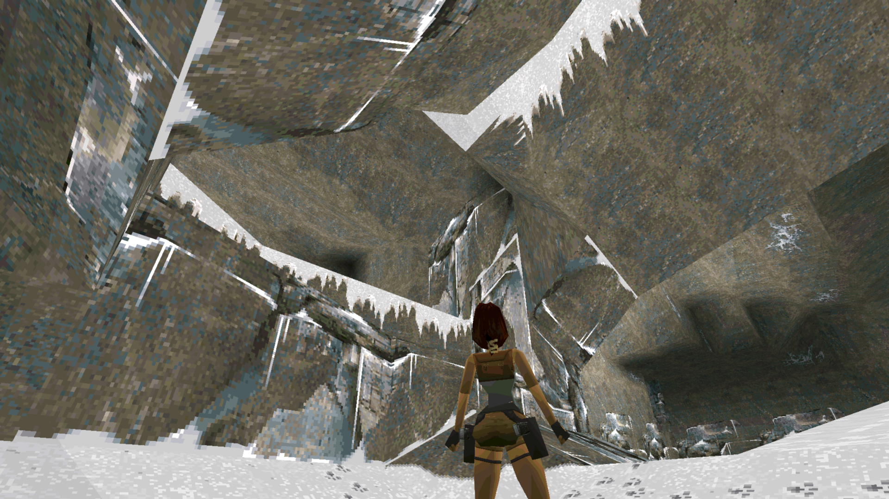

## About

A reconstruction of the 1996 Tomb Raider PC release for modern Windows.

I have two goals for this project.

- A faithful recreation of the DOS version of Tomb Raider 1, with any resolution and unlocked FPS (As well as the ability to play it with 30 FPS and low resolution like the good old days).
- Add some completely new optional ways to play Tomb Raider, such as completely different control schemes.

Essentially, this can be used as an authentic and easier way to play the PC version of Tomb Raider 1, or as a means to experience TR1 in brand new ways. Pick your flavour.

Currently, there are four modes:

- **Original**
   - The original, unaltered experience.
- **Third Person Shooter**
   - With manual mouse-look aiming and much snappier combat.
- **First Person Shooter**
   - A fast-paced mode with greater control for a Boomer Shooter experience.
- **Virtual Reality**
   - Aiming for full immersion with all gameplay systems handled with physical VR interactions.

Plus a good chunk of customisation options ranging from Quality-of-Life improvements, to just pure fun.

I'm not really one for modernising graphics, and the only visual tweaks have been around visual bugs that were present in the DOS version and which detracted from the experience.

## Release Package

As soon as the first release is up, it'll be linked here. But you could download the source and run **build-trbeyond.ps1** followed by **build-setup.ps1** to get you an installer to help extract assests from your original CD or Steam/GOG installations.

## What's Included?

### The original, unaltered experience
In whatever resolution and FPS your machine can muster, or keep it old school with DOS-era resolutions and FPS.

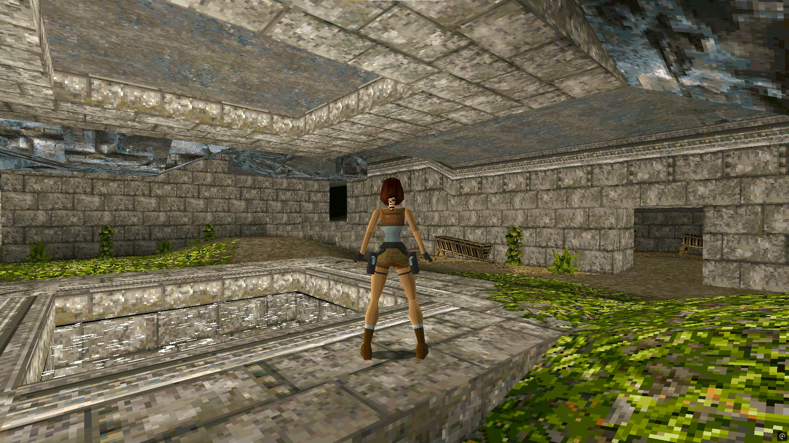
#### Full Resolution

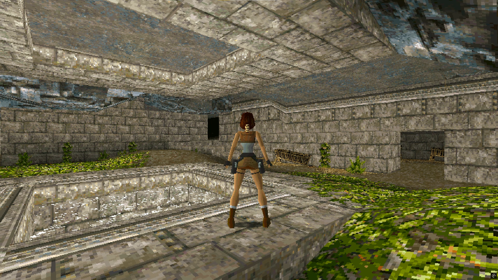
#### DOS "High res" mode with added widescreen

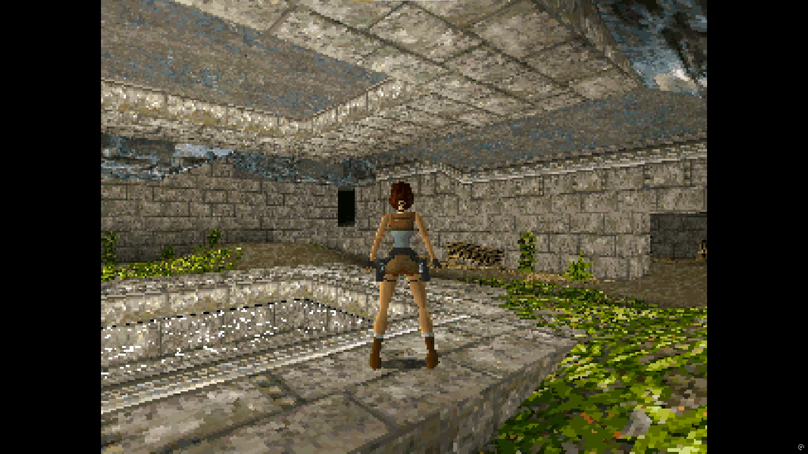
#### DOS "Low res" mode in 4:3 ratio

### Third Person Shooter Mode
WASD movement with mouse-controlled manual aiming. The main goal was to significantly improve Tomb Raider's combat, while still keeping it close enough to feeling like a Tomb Raider game.

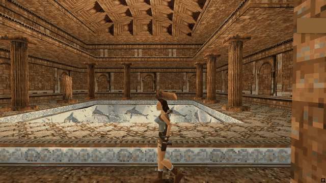
#### Manual mouse-driven aiming

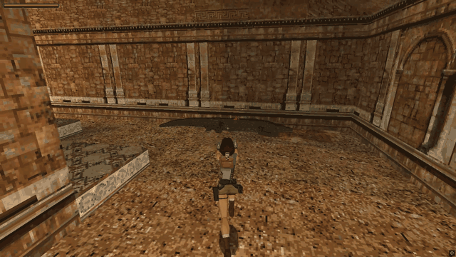
#### Smooth backpedalling without hopping

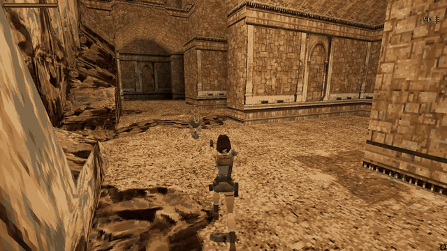
#### Perform flips easily while maintaining aim

### First Person Shooter Mode
A much faster-paced game, with instant pickups and air control. Lara has twice the speed and can zip around levels. If Tomb Raider and Quake had a baby...

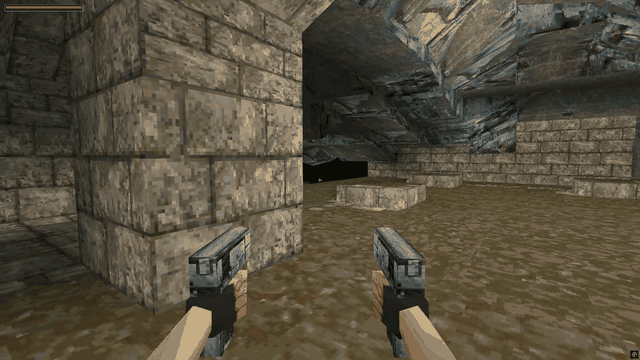
#### Fast movement and quick weapon switching

### Immersive VR
Every gameplay mechanic accounted for, so you never need a third-person view.

| | |
|---|---|
| 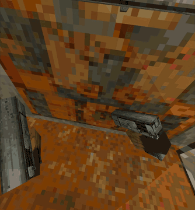 | 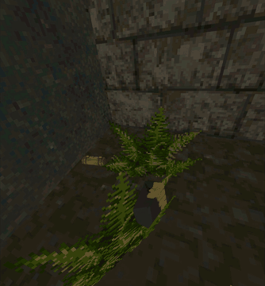 |

#### Every mechanic has a physical VR interaction. No point-and-press-a-button here!

 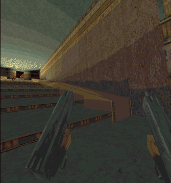
 #### Mix and match weapons without a menu. Each weapon is unholstered from a different place on your body.

 | | |
|---|---|
| 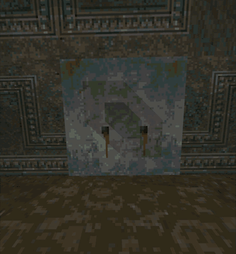 | 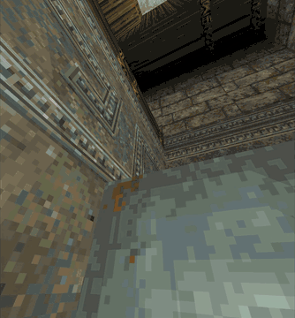 |

#### Easily push and pull blocks,

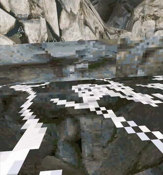
 #### Use natural swimming techniques to move your body in any direction in water.

## Additional Customisation
Includes a bunch of optional customisation options which can be turned on and off at will. Defaults to the pure, unaltered experience. Most of these settings can be used on any game mode.

### Quality of Life
- **Autosave**
   - Auto saves the game after key interactions (using keys, pulling switches, etc).
- **Consistent Weapons**
   - Real-time cutscenes will use the last weapons Lara had equipped, as well as the next level having your last used weapon equipped the start.
   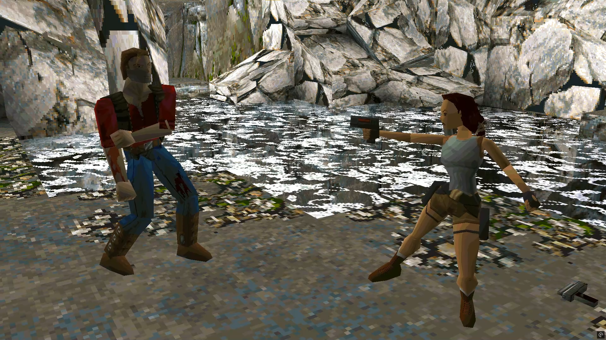
   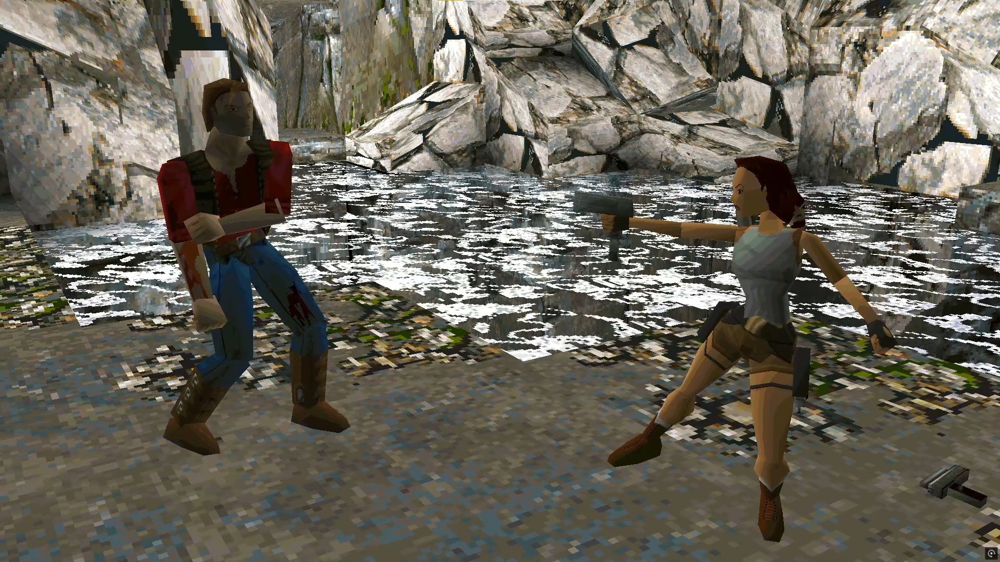
- **3D Pickups**
   - Replaces the sprites with their 3D models from the inventory ring. Especially useful in VR mode.

## Cheats
- **Invincibility**
- **Infinite Ammo**
- **Gun Power**
   - Can set guns to be 2x or 5x stronger. Or set it to One Shot Kill.
- **Give any weapon**

### Fun Stuff
- **No Enemies**
   - Explore the world of Tomb Raider without the threat of enemies.
- **Double-Tap Jump to Swim**
   - Swim in the air! Or walk under water!
- **Max Draw Distance**
   - See the whole area without the fog.
   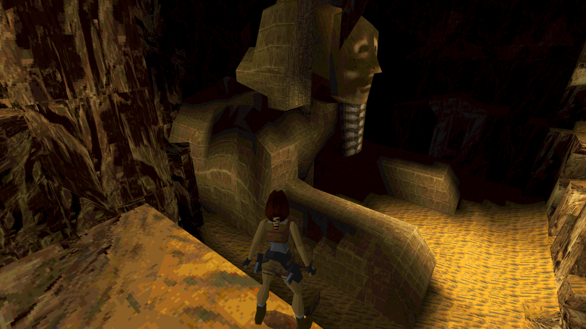
   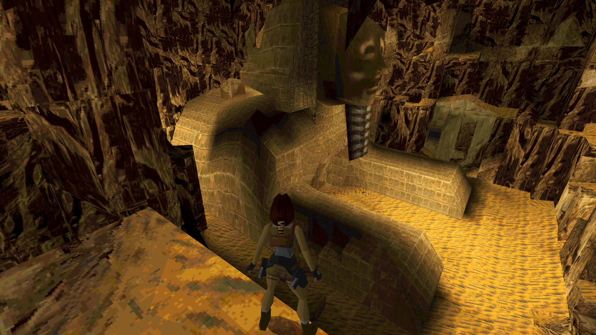
- **Climb Anything in VR**
   - Pretty much what it says on the tin. Explore the levels like a rock climber.

## What's the plan?
Here is the list of things current on the plan.

- [x] Recreate the DOS version of Tomb Raider 1 for modern Windows
- [x] Complete a playthrough of the Original mode
- [x] Create a Third Person Shooter (TPS) Mode
- [x] Refine TPS Mode
- [ ] Complete a TPS playthrough
- [x] Create a First Person Shooter (FPS) Mode
- [x] Refine FPS Mode
- [ ] Complete a FPS playthrough
- [x] Create a Virtual Reality (VR) Mode
- [ ] Refine VR Mode
- [ ] Complete a VR playthrough
- [ ] Add VR Comfort options

### Future Plans
- [ ] Add PlayStation 1 disc and TR Remastered as options to import game data from
- [ ] Add option for PS1 musical cues
- [ ] Add option for PS1 water colours (and maybe lighting)
- [ ] Add option to use Save Crystals
- [ ] Multiplayer... maybe even with mixed modes!