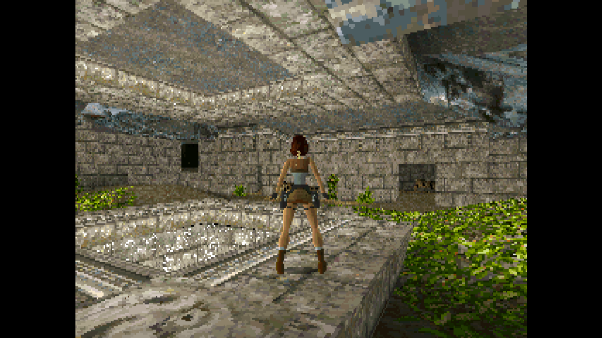
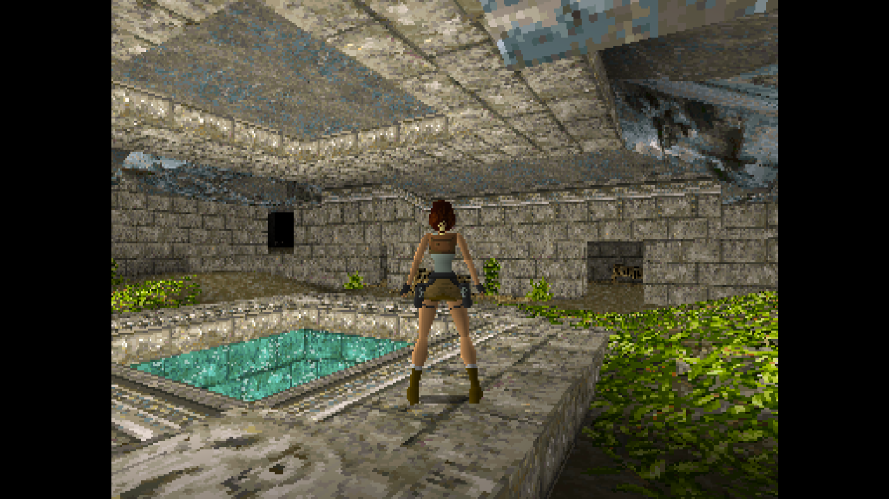
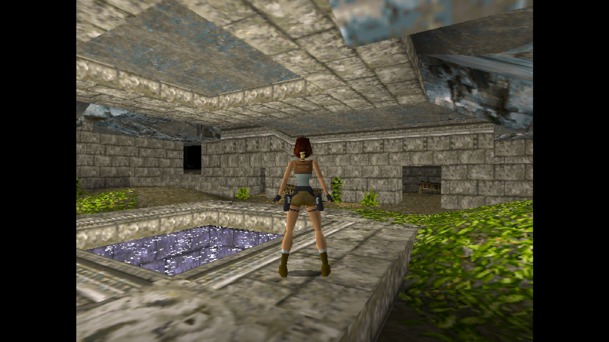
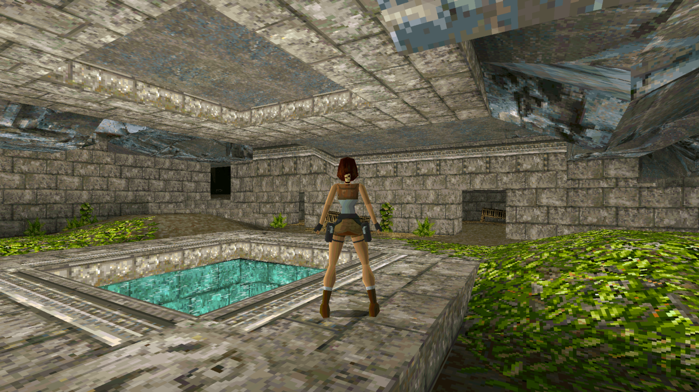

# Tomb Raider Beyond

## About

A reconstruction of the 1996 Tomb Raider PC release for modern Windows.

I have two goals for this project.

- A faithful recreation of the DOS version of Tomb Raider 1
  - Since expanded to include visuals/sounds for DOS 3DFX and PlayStation 1.
- Add some completely new optional ways to play Tomb Raider, such as completely different control schemes.

Essentially, this can be used as an authentic and easier way to play the PC version of Tomb Raider 1, or as a means to experience TR1 in brand new ways. Pick your flavour.

Currently, there are four modes:

- **Original**
   - The original, unaltered experience.
- **Third Person Shooter**
   - With manual mouse-look aiming and much snappier combat.
- **First Person Shooter**
   - A fast-paced mode with greater control for a Boomer Shooter experience.
- **Virtual Reality**
   - Full immersion with all gameplay systems handled with physical VR interactions.

Plus a good chunk of customisation options ranging from Quality-of-Life improvements, to just pure fun.

I'm not really one for modernising graphics, and the only visual tweaks have been around visual bugs that were present in the DOS version and which detracted from the experience.

## Installation

1. Download the latest release from here: https://github.com/nostalgiaisgrief/TRBeyond/releases/latest
2. Run the .exe.
3. Follow the wizard to import game assets from your legally own versions.
4. (Optional) Import game assets from both a DOS version and a PlayStation copy to allow you to mix-and-match your favourite elements from each. For example, DOS level data and its better credit screens, with PS1's audio cues and higher quality videos.

## What's Included?

### The original, unaltered experience
With visual and audio presets for DOS, DOS 3DFX and PlayStation 1. Or mix-and-match your favourite elements from each version for the optimal experience.

#### DOS

#### PlayStation 1

#### DOS 3DFX

#### Optimal (Best elements from each)

### Third Person Shooter Mode
WASD movement with mouse-controlled manual aiming. The main goal was to significantly improve Tomb Raider's combat, while still keeping it close enough to feeling like a Tomb Raider game.

#### Manual mouse-driven aiming

#### Smooth backpedalling without hopping

#### Perform flips easily while maintaining aim

### First Person Shooter Mode
A much faster-paced game, with instant pickups and air control. Lara has twice the speed and can zip around levels. If Tomb Raider and Quake had a baby...

#### Fast movement and quick weapon switching

### Immersive VR
Every gameplay mechanic accounted for, so you never need a third-person view.

#### Every mechanic has a physical VR interaction. No point-and-press-a-button here!
| | |
|---|---|
|  |  |

#### Mix and match weapons without a menu. Each weapon is unholstered from a different place on your body.
 
 
#### Easily push and pull blocks,
 | | |
|---|---|
|  |  |

#### Use natural swimming techniques to move your body in any direction in water.

## Campaigns
Play the original **Tomb Raider**, or the expansion **Unfinished Business** in the original order (Egypt, then Atlantis).

*Or even better...* Play both campaigns combined. As soon as you finish the last level in **Tomb Raider** you immediately begin **Unfinished Business** in Atlantis with all your items. The video of Lara escaping on a boat is only shown after you've finished the two additional Atlantean Levels. And the game credits are kept until you've finished the two additional Egyptain levels.

## Additional Customisation
Includes a bunch of optional customisation options which can be turned on and off at will. Defaults to the pure, unaltered experience. Most of these settings can be used on any game mode.

### Enhancements
- **Autosave**
   - Auto saves the game after key interactions (using keys, pulling switches, etc).
- **Consistent Weapons**
   - Real-time cutscenes will use the last weapons Lara had equipped, as well as the next level having your last used weapon equipped at the start.
   
   
- **3D Pickups**
   - Replaces the sprites with their 3D models from the inventory ring. Especially useful in VR mode.

## Cheats
- **Invincibility**
- **Infinite Ammo**
- **Gun Power**
   - Can set guns to be 2x or 5x stronger. Or set it to One Shot Kill.
- **Give any weapon**

### Fun Stuff
- **No Enemies**
   - Explore the world of Tomb Raider without the threat of enemies.
- **Double-Tap Jump to Swim**
   - Swim in the air! Or walk under water!
- **Max Draw Distance**
   - See the whole area without the fog.
   
   
- **Climb Anything in VR**
   - Pretty much what it says on the tin. Explore the levels like a rock climber.

## What's the plan?
Here is the list of things currently on the plan.

- [x] Recreate the DOS version of Tomb Raider 1 for modern Windows
- [x] Complete a playthrough of the Original mode
- [x] Create a Third Person Shooter (TPS) Mode
- [x] Refine TPS Mode
- [ ] Complete a TPS playthrough
- [x] Create a First Person Shooter (FPS) Mode
- [x] Refine FPS Mode
- [x] Complete a FPS playthrough
- [x] Create a Virtual Reality (VR) Mode
- [ ] Refine VR Mode
- [ ] Complete a VR playthrough
- [ ] Add VR Comfort options
- [x] Add asset import from DOS and PS1 game discs
- [x] Add asset import from Steam/GOG installations
- [x] Add option for PS1 musical cues
- [x] Add option for PS1 water colours
- [x] Add option to use Save Crystals
- [ ] Improve Save Crystal look
- [ ] Multiplayer... maybe even with mixed modes!